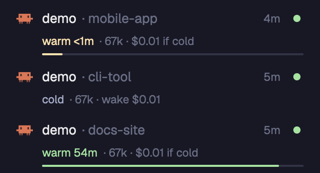

# herdr-claude

Prompt-cache state for every Claude Code session running in Herdr, drawn in Herdr's sidebar, plus a Claude Code status line that shows the same inside each session, and an optional autocompact that sends `/compact` to big idle sessions just before their cache expires.



- A bar under each Claude row drains as the cache lifetime runs out; the label turns amber near the end.
- Under the name: context size, and what the next prompt would cost if the cache went cold.
- The sidebar header counts warm sessions and what waking the cold ones would cost.
- `--track` remembers which Herdr terminal holds which session and resumes Claude in a terminal that lost it.

A warm session reads its context from cache at a tenth of the input price or less.
A cold one writes the whole context into the cache again, at twice the input price for a one-hour cache.
With many sessions open, losing track of which are about to go cold gets expensive.

## What you install

| Piece | What it does | Goes to | Active when |
|---|---|---|---|
| `agents-cache` mod and `main-cache` layout | The sidebar above | `~/.config/herdr-app/` | You pick the `main-cache` layout in Herdr |
| `herdr-claude` | The script the mod calls; also `status`, `autocompact` and `import-tmux` on the command line | `~/.local/bin/` | The mod runs it |
| `herdr-layout` | Pane layouts for the mod's key commands | `~/.local/bin/` | The mod runs it |
| `claude-statusline` | Claude Code status line: cost, git, context and cache state. Works without Herdr | `~/.local/bin/` | A Claude profile's `settings.json` points `statusLine` at it |
| Autocompact config | Turns autocompact on | `~/.config/herdr-claude/config.json` | Only with `./install.sh --autocompact` |

Nothing here edits Claude Code's `settings.json` or Herdr's own config; those changes are listed under [Install](#install) for you or your agent to make.

## How it works

Every 30 seconds the `agents-cache` sidebar mod runs `herdr-claude status --json --track`.
The script finds each Claude session in a Herdr terminal, reads its last request from the transcript, works out the cache lifetime from the cache writes recorded there, and returns JSON the mod draws.
Costs are list-price estimates from the `PRICES` table at the top of the script, for comparing sessions, not a bill.

An optional workstream label under each Claude row names the Workwatch (`ww`) workstream the session is on.
It is off by default and needs Workwatch, which is not public yet.
Turn it on with `{"workwatch": {"enabled": true}}` in `~/.config/herdr-claude/config.json`.

## Requirements

| Need | Why |
|---|---|
| Herdr on macOS, with `hc` (herdr-core) | Runs the sessions and draws the sidebar. Built against Herdr 0.1.16 |
| Claude Code sessions started inside Herdr | Only sessions in Herdr terminals show up |
| `python3` 3.9 or newer | Standard library only |
| `jq` | The status line only |
| `"promptCacheTtl": "1h"` in Claude Code's `settings.json` | With the default five-minute cache the bar empties almost at once |

## Install

### With your agent

You don't need a clone.
Paste this into Claude Code and it fits the pieces into the setup you already have:

```text
Set up herdr-claude from https://github.com/thirteeneight/herdr-claude in my existing setup.
Don't clone the repo. Read its README.md and install.sh first, then fetch only the files listed
under "Files" from https://raw.githubusercontent.com/thirteeneight/herdr-claude/main/<path>
and put each where my setup keeps that kind of thing (scripts on my PATH, Herdr mods and layouts
in my Herdr config). Keep the executable bit on scripts.

- Merge the Claude Code settings from the README into each Claude profile's settings.json I use;
  never replace the file.
- If I already have a statusLine, show me both and ask whether to replace, keep or combine them.
- If my Herdr layout is my own, swap its agents mod for agents-cache instead of switching layouts.
- Ask me before turning on autocompact. Leave the Workwatch label off.
- Verify with `herdr-app check` on the mod and `herdr-claude status`, then tell me where each
  file went so I can update it later.
```

To update, ask your agent to compare those files with the repo's `main` and refresh the ones that changed.

### By hand

```bash
git clone https://github.com/thirteeneight/herdr-claude && cd herdr-claude
./install.sh                # scripts to ~/.local/bin, mod and layout to ~/.config/herdr-app
./install.sh --autocompact  # same, and writes the autocompact config if you have none
```

Re-run `./install.sh` after `git pull` to update.

Then:

1. Pick `main-cache` as your layout in Herdr. It is Herdr's `main` layout with the agents panel swapped for `agents-cache`. If you use your own layout, replace its `agents` mod with `agents-cache`.
2. Add to `~/.claude/settings.json` (or each profile's), then start new sessions. Leave out `statusLine` if you want to keep your own:

    ```json
    "promptCacheTtl": "1h",
    "autoCompactWindow": 500000,
    "statusLine": {"type": "command", "command": "~/.local/bin/claude-statusline"}
    ```

3. Check with `herdr-claude status`: every Claude session in Herdr shows as warm, cold or working.

### More than one Claude profile

Sessions are found under `~/.claude` by default.
If you run identities with `CLAUDE_CONFIG_DIR`, list each with the command that launches it (used to resume a session) in `~/.config/herdr-claude/config.json`:

```json
{
  "profiles": {
    "~/.claude": "claude",
    "~/.claude-work": "work-claude"
  }
}
```

`HERDR_CLAUDE_PROFILES="~/.claude=claude:~/.claude-work=work-claude"` overrides the file, but Herdr only sees it if it is in the environment Herdr starts with.

## Status line

`claude-statusline` puts the cache state at the bottom of each Claude Code session, in or out of Herdr.
For example:

```text
$12.40 · Opus 5.5
➜  api-server git:(main) ✗ (in 1.2k · out 85.3k · cache 21.4M)
Ctx 250.0k [██████░░░░░░] next turn ~$0.05 · cache warm til 14:32 · compact at next milestone
```

- Line 1: what the session has cost so far, subagents included, and the model.
- Line 2: folder, git branch, a cross when there are uncommitted changes, and token totals.
- Line 3: context size against `autoCompactWindow` (`STATUSLINE_CTX_CAP` overrides it), what the next turn costs while warm, and when the cache expires. It turns amber at 200k and red past 400k.
- When the cache is cold, line 3 shows what resuming would cost instead.

With `{"workwatch": {"enabled": true}}` in `~/.config/herdr-claude/config.json`, line 1 also names the session's Workwatch workstream.

## Autocompact

Off unless the config has an `autocompact` block (`./install.sh --autocompact` writes one):

```json
{
  "autocompact": {
    "enabled": true,
    "before_seconds": 120,
    "min_context_tokens": 200000
  }
}
```

When a session is idle and within `before_seconds` of its cache expiring, the script types `/compact` into its terminal through `hc`.
The session still goes cold an hour later, but when you come back the cache rebuilds from the compacted context instead of the full one.

The compacted context is smaller, not small.
Across 45 compactions measured on 25 November 2026, the middle half landed between 79k and 91k tokens, none below 73k, whatever the size before: the system prompt, tools, CLAUDE.md and re-read files stay.
So the saving per return is roughly the original size minus that floor, and below about 200k tokens it is not worth losing the detail compaction drops.

It sends only when every check passes:

| Check | How it's read |
|---|---|
| Cache warm and inside the window | The transcript, as for the sidebar |
| Context at least `min_context_tokens` | Tokens of the last request |
| Session idle | `hc get` reports Claude Code idle or done; anything else skips |
| Input line empty, no dialog | `hc read` shows an empty prompt |
| Not already sent this cache window | State file in `~/.local/state/herdr-claude/` |
| Not compacted in the last 10 minutes | The transcript |

```bash
herdr-claude autocompact --dry-run   # what it would do, per session, and why
herdr-claude autocompact-report      # per send: resumed or not, minutes until resumed, context before and after
```

Sends and skips are logged as JSON lines in `~/.local/state/herdr-claude/autocompact.log`.

## Troubleshooting

| Symptom | Cause and fix |
|---|---|
| `herdr-core is not running` | Open Herdr first; the script never starts the core |
| A session is missing | It isn't in a Herdr terminal, or its config folder isn't a profile. Add it under `profiles` |
| Sessions started from Herdr say "Login expired" | Herdr started `claude` without your login shell. Point Herdr's Claude entry at a wrapper in `~/.config/herdr-app/programs.json`, e.g. `{"programs": {"claude": {"run": ["my-claude"]}}}` |
| Bar empties within minutes | Five-minute cache. Set `promptCacheTtl` to `1h` and start a new session |
| Autocompact never fires | `herdr-claude autocompact --dry-run` gives the reason per session |
| Mod doesn't load | `herdr-app check ~/.config/herdr-app/mods/agents-cache`, and look for `.error` files beside it |

## Limits

- Prices are hand-kept in two places, `PRICES` in `herdr-claude` and `price` in the status line; update both when prices change.
- The status line skips Haiku 5.5's higher rate for long prompts, so it underestimates those.
- The mod is a modified copy of Herdr's own agents panel and doesn't follow Herdr's updates to it.
- Autocompact can't tell Claude's greyed placeholder from typed text, so it skips a session showing one.

## Files

| Path | Installed to |
|---|---|
| `bin/herdr-claude` | `~/.local/bin/` |
| `bin/herdr-layout` (pane layouts the mod's key commands use) | `~/.local/bin/` |
| `claude/statusline.sh` | `~/.local/bin/claude-statusline` |
| `herdr-app/mods/agents-cache/main.js`, `mod.json` | `~/.config/herdr-app/mods/agents-cache/` |
| `herdr-app/layouts/main-cache.json` | `~/.config/herdr-app/layouts/` |
| `config/autocompact.json` | `~/.config/herdr-claude/config.json` (with `--autocompact`) |

## License

MIT, see `LICENSE`.
`herdr-app/` is derived from Herdr's bundled agents mod and main layout and stays under Apache-2.0; see `herdr-app/LICENSE-herdr`.
